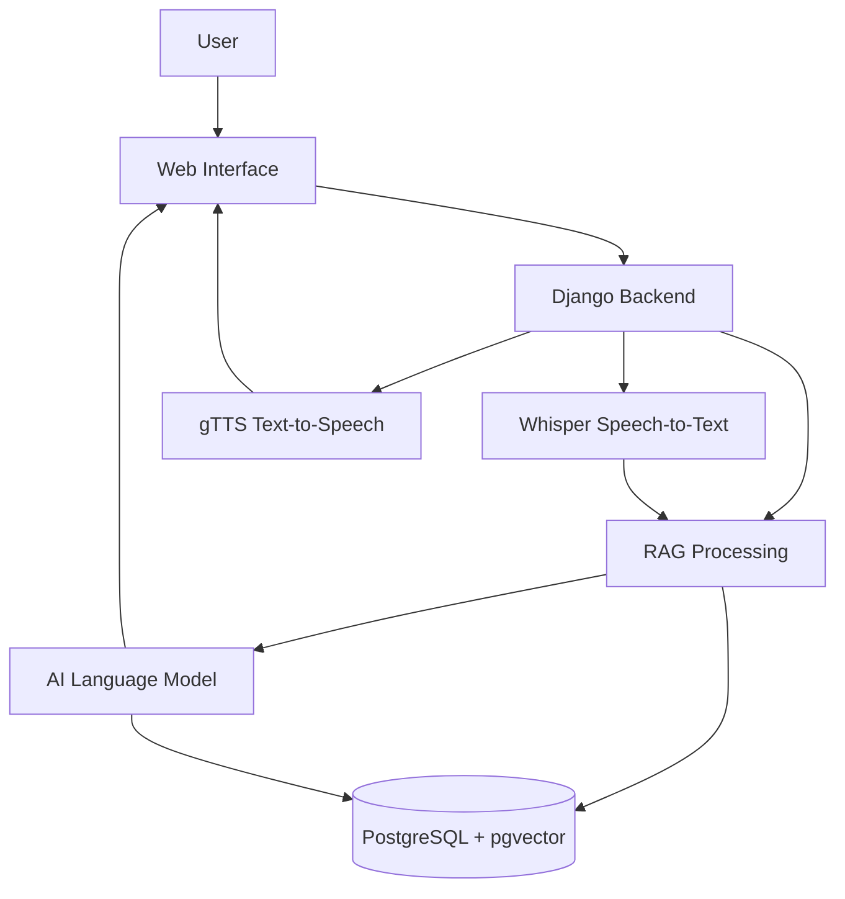
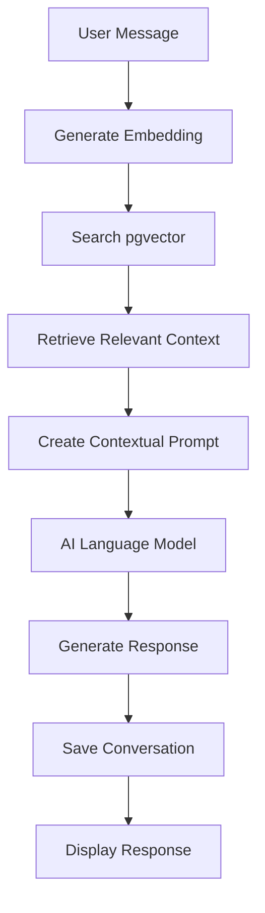

# AI Voice & Text Assistant with RAG

An AI-powered web application that allows users to communicate with an AI assistant using text and voice. The application supports **English only** and uses Retrieval-Augmented Generation (RAG) to retrieve relevant information from previous conversations and generate contextual responses.

**Technology Stack:** Django, PostgreSQL, pgvector, OpenAI Whisper, gTTS, HTML, CSS, and JavaScript.

## 1. Project Overview

The application provides three main features through a simple web interface:

1. **Text-to-Text (TTT):** Users type a message and receive an AI-generated text response.
2. **Speech-to-Text (STT):** Users speak in English, and Whisper converts their speech into text.
3. **Text-to-Speech (TTS):** The application converts text or AI-generated responses into spoken English audio using gTTS.

The system stores conversation history in PostgreSQL and uses RAG to retrieve relevant information from previous conversations.

## 2. Key Features

- Simple interface with a central interaction button.
- English-only voice and text interaction.
- Speech recognition using OpenAI Whisper.
- English speech generation using gTTS.
- AI-generated responses using a language model.
- Conversation history stored in PostgreSQL.
- Semantic search using pgvector.
- RAG-based contextual responses.
- Basic user authentication and data protection.

## 3. System Architecture

The application consists of four main layers.



### Components

- **Frontend:** HTML, CSS, and JavaScript.
- **Backend:** Django handles requests and application logic.
- **Speech-to-Text:** Whisper converts English speech into text.
- **Text-to-Speech:** gTTS generates English audio.
- **RAG:** Retrieves relevant conversation information before generating a response.
- **Database:** PostgreSQL stores messages, conversations, and embeddings.
- **Vector Search:** pgvector finds semantically similar stored information.
- **Language Model:** Generates AI responses using the retrieved context.

## 4. Working of the Application

### A. Text-to-Text

1. The user enters an English message.
2. Django receives the message.
3. The RAG system searches for relevant previous conversations.
4. The language model generates a contextual response.
5. The conversation is stored in PostgreSQL.
6. The response appears on the screen.

### B. Speech-to-Text

1. The user activates the microphone.
2. The application records English speech.
3. Whisper converts the audio into text.
4. The transcript appears on the screen.
5. The user can submit it to the AI assistant.
6. The transcript and resulting response are saved.

### C. Text-to-Speech

1. The user enters text or selects an AI response.
2. Django sends the text to gTTS.
3. gTTS generates an MP3 audio file.
4. The application returns the audio to the frontend.
5. The user plays the generated English audio.

## 5. RAG Architecture

RAG helps the AI assistant use relevant information stored in previous conversations.



### RAG Workflow

1. Receive the user's message.
2. Convert the message into a numerical embedding.
3. Search PostgreSQL using pgvector.
4. Retrieve relevant stored information.
5. Send the message and retrieved context to the language model.
6. Generate and display the response.
7. Save the new conversation for future retrieval.

**Note:** PostgreSQL stores the conversation data, while pgvector supports similarity search. An embedding model and a language model are also required; they are not automatically provided by Django or PostgreSQL.

## 6. Technology Stack

| Component | Technology |
|---|---|
| Frontend | HTML, CSS, JavaScript |
| Backend | Python, Django |
| API | Django REST Framework |
| Database | PostgreSQL |
| Vector Search | pgvector |
| Speech-to-Text | OpenAI Whisper |
| Text-to-Speech | gTTS |
| Embeddings | Sentence Transformers |
| AI Responses | Compatible LLM API or local model |
| Version Control | Git and GitHub |

## 7. Database Design

The initial application can use three main tables.

| Table | Purpose |
|---|---|
| Users | Stores user account information |
| Conversations | Stores conversation details |
| Messages | Stores user messages, AI responses, and embeddings |

Each message belongs to a conversation. Embeddings can be stored alongside message records or in a separate table if needed.

## 8. Basic Project Structure

```text
ai_voice_assistant/
├── manage.py
├── requirements.txt
├── .env
├── config/
│   ├── settings.py
│   └── urls.py
├── apps/
│   ├── conversations/
│   │   ├── models.py
│   │   └── views.py
│   ├── speech/
│   │   ├── stt.py
│   │   └── tts.py
│   └── rag/
│       ├── embeddings.py
│       ├── retriever.py
│       └── pipeline.py
├── templates/
├── static/
│   ├── css/
│   └── js/
└── tests/
```

## 9. Required Python Packages

```text
Django
djangorestframework
psycopg[binary]
pgvector
openai-whisper
gTTS
sentence-transformers
python-dotenv
```

Install FFmpeg separately for local Whisper processing. Add the SDK or package required by the chosen language model.

## 10. Security and Language Support

- The application will support English only.
- English audio will be transcribed using Whisper.
- Responses will be generated in English.
- gTTS will generate English speech using its English language setting.
- User conversations must be protected through authentication and access controls.
- API keys and database credentials must be stored in environment variables.
- Audio files should be stored temporarily and deleted when no longer required.

English-only support should be enforced through application instructions and validation. Speech recognition may still produce imperfect transcripts, so the application should allow users to review and correct them.

## 11. Development Roadmap

- [ ] Set up Django and PostgreSQL.
- [ ] Create the basic web interface.
- [ ] Implement text-to-text interaction.
- [ ] Integrate Whisper for English speech recognition.
- [ ] Integrate gTTS for English speech output.
- [ ] Store conversations in PostgreSQL.
- [ ] Enable pgvector and implement embeddings.
- [ ] Build the RAG retrieval and response-generation pipeline.
- [ ] Connect all three interaction modes.
- [ ] Test the application and improve error handling.

## 12. Expected Outcome

The final application will provide a simple English-only AI assistant that accepts text and speech, generates AI responses, speaks responses aloud, and stores conversations for contextual retrieval.

The project will demonstrate the practical integration of Django, PostgreSQL, speech-processing technologies, and Retrieval-Augmented Generation in a single web application.
