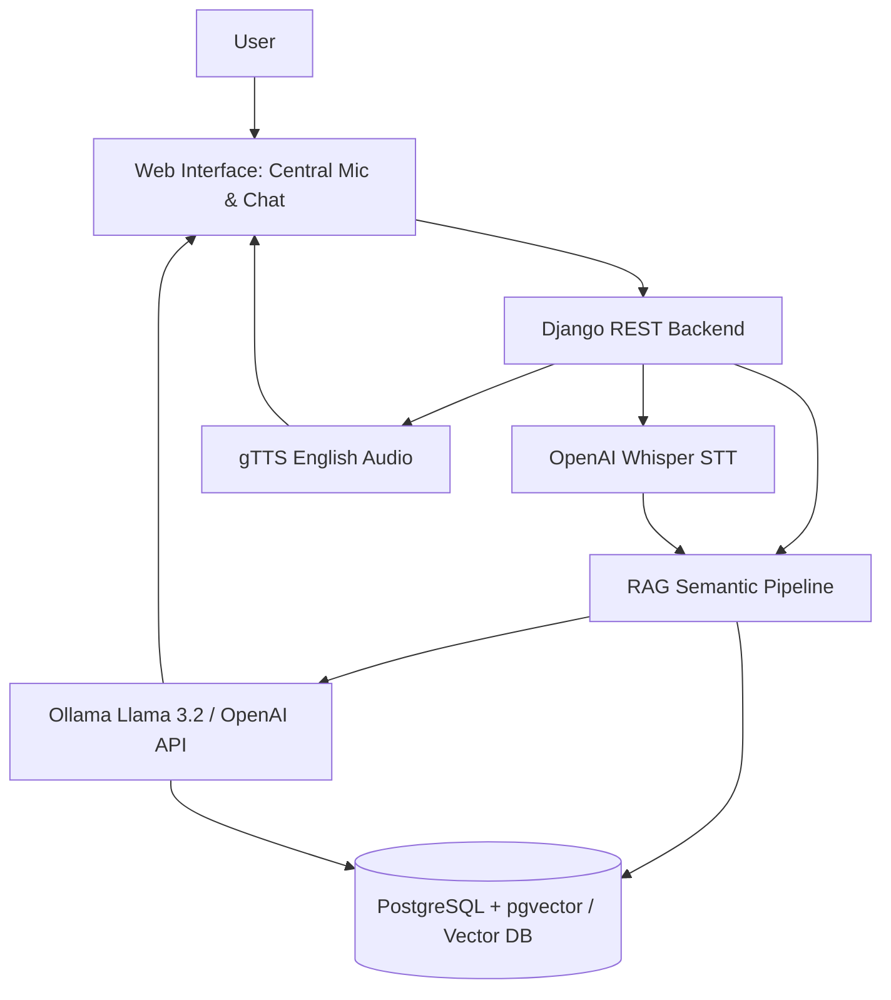

# 🎙️ AI Voice & Text Assistant with RAG (ADAWAT)

An AI-powered web application that allows users to communicate with an AI assistant using text and voice. The application supports **English only** and uses **Retrieval-Augmented Generation (RAG)** to retrieve relevant information from previous conversations and generate contextual, speech-enabled responses.

Built with **Django**, **PostgreSQL**, **pgvector**, **OpenAI Whisper**, **gTTS**, **HTML**, **CSS**, and **JavaScript**.

---

## 🌟 Key Features

1. **Text-to-Text (TTT):**
   - Type messages in English with instant AI responses.
   - Preserves conversation turns and integrates contextual knowledge across past discussions.

2. **Speech-to-Text (STT):**
   - Click or hold the glowing central microphone button to record English speech.
   - Live real-time audio waveform visualizer via the Web Audio API.
   - High-accuracy speech transcription powered by **OpenAI Whisper**.
   - Seamless browser Web Speech API fallback for maximum browser compatibility.

3. **Text-to-Speech (TTS):**
   - Generates natural, clear English spoken audio using **gTTS** (Google Text-to-Speech).
   - "Listen" audio player directly on assistant responses.
   - Automatic cleanup of temporary audio files to preserve disk space.

4. **Retrieval-Augmented Generation (RAG) & Vector Search:**
   - Converts English messages into numerical semantic vector embeddings (384-dimensional).
   - Queries stored conversations using **PostgreSQL + pgvector** cosine distance.
   - Weaves retrieved memories into contextual prompts for the language model.
   - Dedicated **Semantic Memory Inspector** modal to test vector similarity queries interactively.

5. **Multi-Provider LLM Engine:**
   - Supports local offline LLMs via **Ollama** (`llama3.2:1b` pre-configured).
   - Supports **OpenAI** API (`gpt-4o-mini`).
   - Built-in intelligent rule fallback for zero-downtime offline testing.

6. **Rich Modern Frontend:**
   - Glassmorphism dark-mode UI with sleek glowing micro-animations.
   - Full conversation management (create, switch, delete, clear all).
   - Responsive layout for desktop, tablets, and mobile devices.

---

## 🏗️ System Architecture



---

## 🚀 Quick Start Guide

### 1. Prerequisites
- **Python 3.10+** (Python 3.11 recommended)
- **Ollama** (optional for local LLM, or set `OPENAI_API_KEY` in `.env`)
- **PostgreSQL 15+ with pgvector** (optional: falls back to SQLite automatically if PostgreSQL is not configured!)

### 2. Virtual Environment Setup
```bash
# Clone or navigate to the repository
cd Adawat

# Activate the virtual environment
# On Windows PowerShell:
.\.venv\Scripts\Activate.ps1
# On Linux/macOS:
source .venv/bin/activate

# Install dependencies
pip install -r requirements.txt
```

### 3. Environment Configuration
Copy `.env.example` to `.env` (already created with sensible defaults):
```bash
cp .env.example .env
```

Key variables in `.env`:
```ini
SECRET_KEY=django-insecure-voice-rag-assistant-super-secret-key-2026
DEBUG=True
ALLOWED_HOSTS=*

# Database: SQLite (default zero-config) or PostgreSQL with pgvector
DB_ENGINE=django.db.backends.sqlite3
DB_NAME=db.sqlite3

# For PostgreSQL with pgvector:
# DB_ENGINE=django.db.backends.postgresql
# DB_NAME=voice_assistant_db
# DB_USER=postgres
# DB_PASSWORD=your_password
# DB_HOST=localhost
# DB_PORT=5432

# Language Model Provider ('ollama' or 'openai')
LLM_PROVIDER=ollama
OLLAMA_BASE_URL=http://127.0.0.1:11434
OLLAMA_MODEL=llama3.2:1b

# Optional OpenAI key if using OPENAI
OPENAI_API_KEY=
```

### 4. Run Migrations & Start Server
```bash
# Apply database migrations
python manage.py migrate

# Start the Django development server
python manage.py runserver
```

Open your browser at **[http://127.0.0.1:8000/](http://127.0.0.1:8000/)**.

---

## 📡 REST API Reference

| Method | Endpoint | Description |
|---|---|---|
| `GET` | `/` | Main interactive Voice & Text web application |
| `POST` | `/api/rag/chat/` | Combined RAG chat endpoint (accepts text, queries pgvector, generates response & TTS audio) |
| `GET` | `/api/rag/search/?q={query}` | Searches pgvector database for semantically similar previous messages |
| `GET` | `/api/rag/stats/` | Returns system status, active LLM, and embedding count |
| `POST` | `/api/speech/stt/` | Uploads audio recording and returns Whisper English transcript |
| `POST` | `/api/speech/tts/` | Converts English text into spoken MP3 audio via gTTS |
| `GET, POST` | `/api/conversations/` | List all conversations or create a new conversation |
| `GET` | `/api/conversations/{id}/` | Get conversation details or delete conversation |
| `GET` | `/api/conversations/{id}/export/?export_type=text` | Export conversation as formatted text or JSON |
| `POST` | `/api/conversations/clear/` | Clears all conversation history |

---

## 🐳 Quick Start PostgreSQL with pgvector (Optional)

To run a production-grade PostgreSQL instance with pgvector using Docker:
```bash
# Start PostgreSQL 16 with pgvector in the background
docker compose up -d

# Set in your .env file:
# DB_ENGINE=django.db.backends.postgresql
# DB_NAME=voice_assistant_db
# DB_USER=postgres
# DB_PASSWORD=postgres
# DB_HOST=localhost
# DB_PORT=5432

# Apply migrations (pgvector extension is activated automatically)
python manage.py migrate
```

---

## 🧪 Running Automated Tests

Run the complete test suite covering conversations, speech synthesis, embeddings, and RAG pipelines:
```bash
# On Windows PowerShell:
.\.venv\Scripts\python.exe manage.py test

# On Linux/macOS:
python manage.py test
```

---

## 🔒 Security & English-Only Enforcement

- **English-Only Instructions:** The LLM system prompt strictly mandates English responses.
- **Whisper & gTTS Settings:** Enforced `language='en'` and `lang='en'` parameters.
- **Audio Storage Hygiene:** Audio files are stored temporarily in `media/audio/` and automatically pruned via cleanup routines to prevent unneeded disk accumulation.
- **Safe Environment Variables:** Database credentials and API keys are managed exclusively via `.env`.

