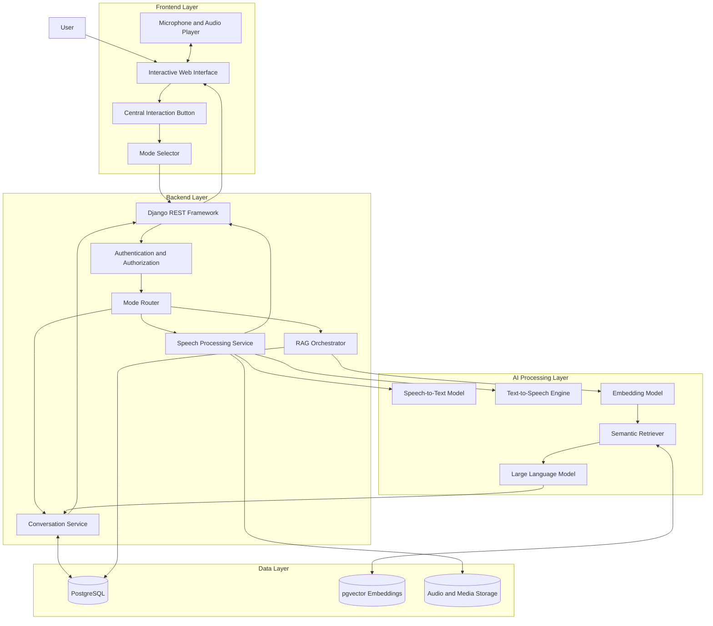
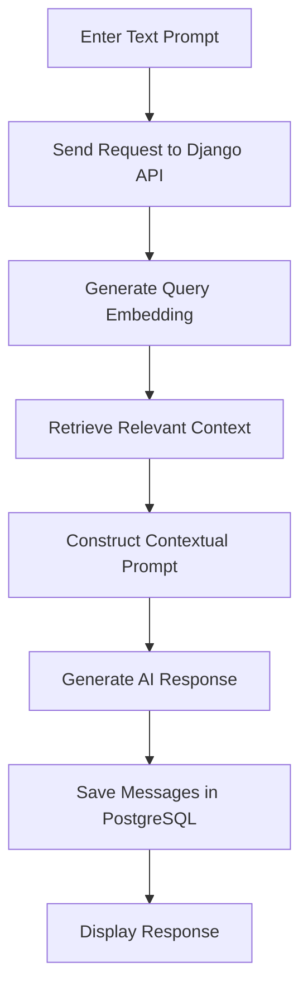
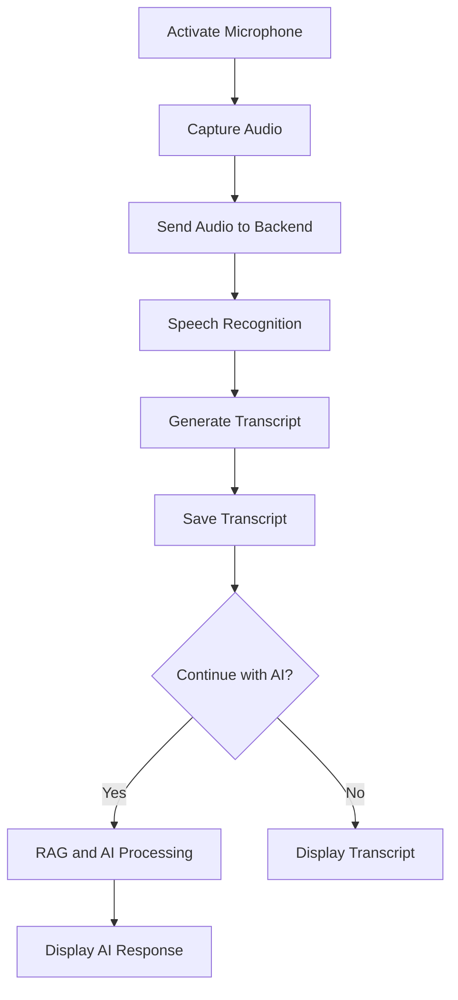
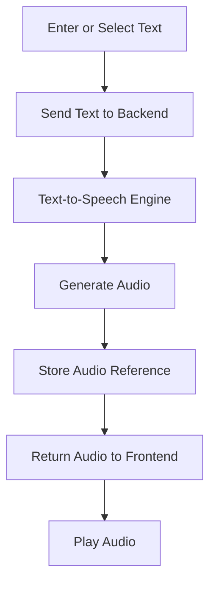
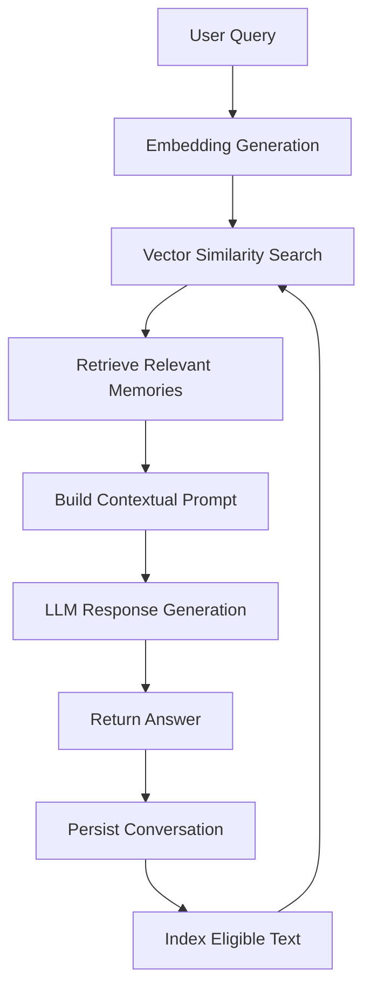
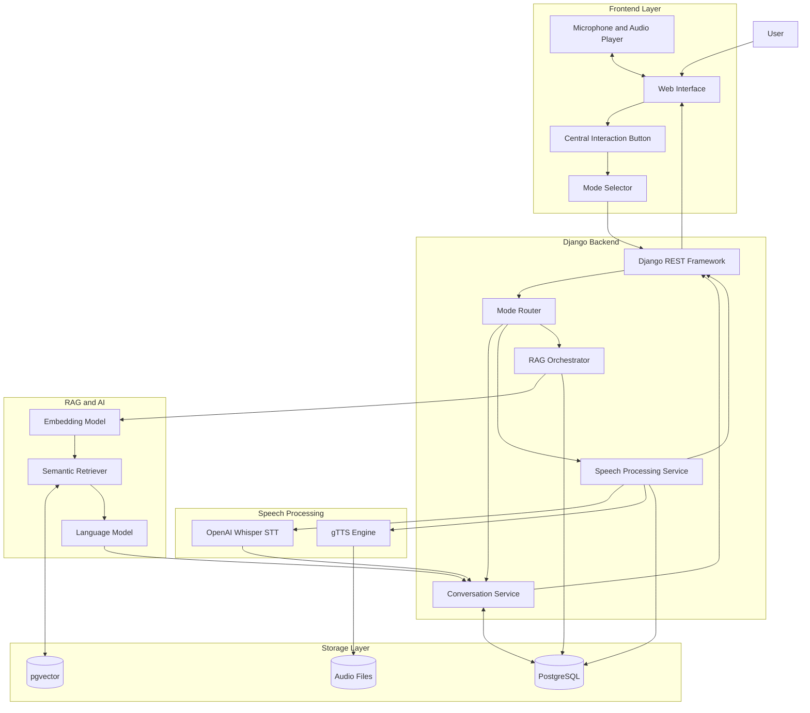
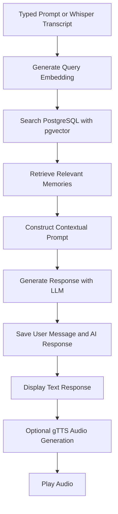

# AI Voice & Text Assistant with RAG

An AI-powered web application that combines **Text-to-Speech (TTS), Speech-to-Text (STT), and Text-to-Text (TTT)** through a unified interactive interface. The application uses Retrieval-Augmented Generation (RAG) to retrieve relevant information from stored conversations and generate context-aware responses.

Built using Django, PostgreSQL, and modern AI and speech-processing technologies.

## Table of Contents

- [Project Overview](#project-overview)
- [Key Features](#key-features)
- [System Architecture](#system-architecture)
- [Interaction Workflow](#interaction-workflow)
- [RAG Architecture](#rag-architecture)
- [Technology Stack](#technology-stack)
- [Database Design](#database-design)
- [API Design](#api-design)
- [Project Structure](#project-structure)
- [Security and Privacy](#security-and-privacy)
- [Development Roadmap](#development-roadmap)

## Project Overview

The goal of this project is to build a unified AI assistant that allows users to interact naturally through text and voice.

A central interaction button serves as the primary control for selecting and activating the application's three modes:

1. **Text-to-Text:** Submit a text prompt and receive an AI-generated response enhanced with relevant retrieved context.
2. **Speech-to-Text:** Record speech, convert it into text, and optionally submit the transcription to the AI assistant.
3. **Text-to-Speech:** Convert user-provided text or an AI-generated response into spoken audio.

The application maintains conversation history in PostgreSQL and uses vector-based semantic retrieval to make relevant stored information available to the AI model.

## Key Features

- Unified interface with a central interaction button.
- Text-based AI conversations.
- Speech recognition and transcription.
- Text-to-speech audio generation.
- Retrieval-Augmented Generation for context-aware responses.
- Persistent conversation history.
- Semantic search over stored conversation memories.
- PostgreSQL database with pgvector for vector similarity search.
- Modular Django backend.
- User authentication and conversation access controls.
- Extensible architecture for future AI capabilities.

## System Architecture

The architecture separates the frontend, backend services, AI processing, and persistent storage.



### Architecture Components

| Component | Responsibility |
|---|---|
| Frontend | Provides the central button, mode selector, text input, microphone controls, and audio playback. |
| Django REST Framework | Exposes APIs and coordinates application services. |
| Authentication | Protects accounts and restricts access to user-owned data. |
| Mode Router | Directs requests to the appropriate processing pipeline. |
| Speech Service | Coordinates transcription and speech synthesis. |
| RAG Orchestrator | Coordinates embeddings, retrieval, prompt construction, and AI generation. |
| PostgreSQL | Stores users, conversations, messages, and metadata. |
| pgvector | Stores and searches vector embeddings for semantic retrieval. |
| AI Models | Perform speech recognition, speech synthesis, embedding generation, and text generation. |
| Media Storage | Stores audio files and other large media assets outside the relational database. |

## Interaction Workflow

The central button activates the selected mode.

### 1. Text-to-Text



### 2. Speech-to-Text



### 3. Text-to-Speech



## RAG Architecture

Retrieval-Augmented Generation combines stored knowledge with an AI language model to improve the relevance of responses.

### RAG Workflow



### How RAG Works

1. **Input:** Receive a typed prompt or a speech transcription.
2. **Embedding:** Convert the query into a numerical vector.
3. **Retrieval:** Search pgvector for semantically similar stored text.
4. **Context construction:** Combine the query with relevant retrieved memories.
5. **Generation:** Send the contextual prompt to the selected language model.
6. **Persistence:** Store the user input and assistant response.
7. **Indexing:** Generate embeddings for eligible text so it can be retrieved in future queries.

The application should restrict retrieval to authorized user data and use appropriate indexing and deduplication policies.

**Important:** PostgreSQL stores the original records, while pgvector enables similarity search. RAG is primarily used for contextual text generation; speech transcription and synthesis can operate independently.

##Technology Stack

| Layer | Technology | Purpose |
|---|---|---|
| Frontend | HTML, CSS, JavaScript | Interactive UI and central button |
| Backend | Python, Django | Application logic |
| REST API | Django REST Framework | Frontend-backend communication |
| Database | PostgreSQL | Persistent data storage |
| Vector Search | pgvector | Semantic memory retrieval |
| Speech-to-Text | OpenAI Whisper | Transcribe user speech into text |
| Text-to-Speech | gTTS (Google Text-to-Speech) | Convert text into spoken audio |
| RAG Pipeline | Python-based RAG or LangChain | Context retrieval and prompt construction |
| Embeddings | Sentence Transformers or embedding API | Generate vectors for semantic search |
| Language Model | Hosted LLM API or local model | Generate contextual text responses |
| Audio Storage | Local filesystem initially | Store generated audio files |
| Version Control | Git and GitHub | Source code management |

## Updated System Architecture



## Speech Processing Architecture

### 1. Speech-to-Text using Whisper

Whisper will process recorded audio and convert it into a text transcript.

**Workflow:**

1. User selects Speech-to-Text mode.
2. The browser records audio through the microphone.
3. Audio is uploaded to the Django backend.
4. The Whisper model transcribes the recording.
5. Django stores the transcript in PostgreSQL.
6. The transcript is displayed to the user.
7. Optionally, the transcript is passed to the RAG pipeline to generate an AI response.

Whisper can be run locally or accessed through a compatible hosted API. For local execution, the Python package `openai-whisper` requires FFmpeg and a compatible PyTorch environment.

### 2. Text-to-Speech using gTTS

gTTS will convert text into an MP3 audio file.

**Workflow:**

1. User enters text or selects an AI-generated response.
2. Django sends the text to the gTTS library.
3. gTTS generates an MP3 file.
4. The file is stored temporarily or in configured media storage.
5. Django returns an audio URL or media reference.
6. The frontend plays the generated audio.
7. The text and audio metadata are saved for future access.

**Important:** gTTS requires an internet connection because it uses Google's online text-to-speech service. It is not an offline TTS engine.

## Updated RAG Workflow



The RAG pipeline will handle text prompts and Whisper transcripts. Once the AI generates a response, gTTS can optionally speak the response aloud.

## Additional Python Dependencies

```text
Django
djangorestframework
psycopg[binary]
pgvector
openai-whisper
gTTS
python-dotenv
```

Add other packages as required by your chosen embedding model, language model, and audio-processing implementation. Install FFmpeg separately for local Whisper processing.

## Updated Project Structure

```text
ai_voice_assistant/
├── manage.py
├── requirements.txt
├── .env
├── config/
│   ├── settings.py
│   └── urls.py
├── apps/
│   ├── accounts/
│   ├── conversations/
│   ├── speech/
│   │   ├── stt.py          # Whisper transcription
│   │   ├── tts.py          # gTTS audio generation
│   │   └── views.py
│   ├── rag/
│   │   ├── embeddings.py
│   │   ├── retriever.py
│   │   ├── generator.py
│   │   └── pipeline.py
│   └── media/
│       └── storage.py
├── templates/
├── static/
│   ├── css/
│   └── js/
└── tests/
```

## Updated Development Roadmap

- [ ] Configure Django and PostgreSQL.
- [ ] Enable pgvector for semantic search.
- [ ] Build the central-button interface and mode selector.
- [ ] Integrate Whisper for speech transcription.
- [ ] Integrate gTTS for audio generation.
- [ ] Save transcripts, prompts, and responses in PostgreSQL.
- [ ] Implement embeddings and RAG retrieval.
- [ ] Connect Whisper transcripts to the AI response pipeline.
- [ ] Add optional spoken AI responses using gTTS.
- [ ] Test error handling, permissions, and audio playback.
